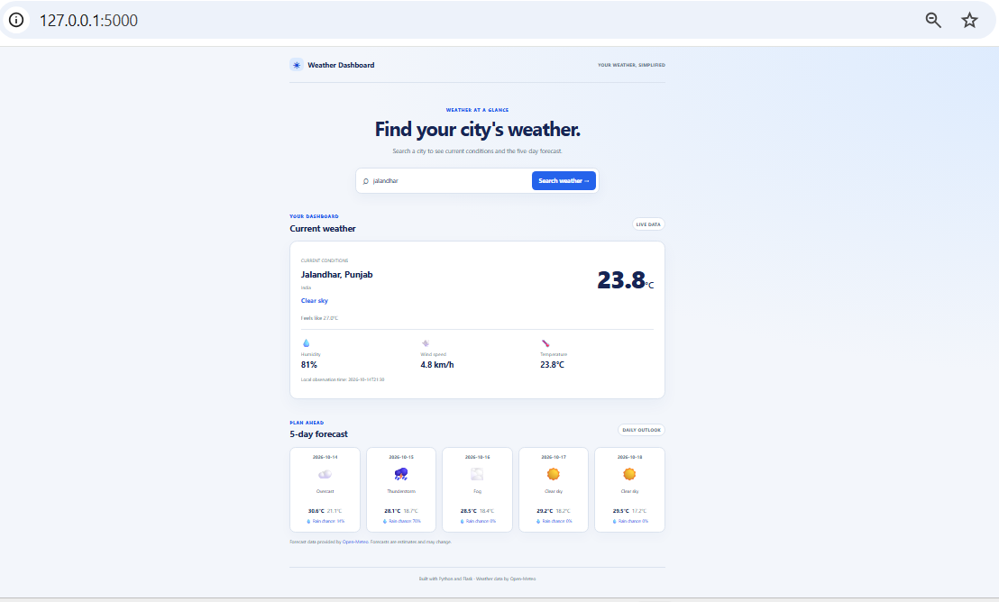

# 🌦️ Weather Dashboard

A Python Flask web application that displays real-time weather information and a five-day weather forecast for cities around the world.

Users can search for a city to view current weather conditions, temperature, humidity, wind speed, and upcoming forecasts through a clean and responsive interface.

## 📸 Screenshot



## ✨ Features

- 🔍 **City Search:** Search for weather information by city name.
- 🌡️ **Current Weather:** View current temperature and weather conditions.
- 💧 **Humidity Information:** Check the current humidity level.
- 💨 **Wind Speed:** View current wind speed.
- 📅 **Five-Day Forecast:** Explore upcoming weather conditions and daily temperatures.
- 🌤️ **Weather Descriptions:** Display readable descriptions of weather conditions.
- 📱 **Responsive Design:** Use the dashboard on desktop and mobile screens.
- ⚠️ **Error Handling:** Handle invalid city names and weather service connection errors.
- 🧪 **Automated Tests:** Verify application functionality using pytest.

## 🛠️ Technologies Used

- **Python** — Application logic and weather data processing
- **Flask** — Web framework
- **HTML5** — Page structure
- **CSS3** — Styling and responsive layout
- **Open-Meteo API** — Weather forecasts and current weather data
- **pytest** — Automated testing
- **Git & GitHub** — Version control and project hosting

## 📂 Project Structure

```text
weather-dashboard/
│
├── app.py
├── requirements.txt
├── README.md
├── .gitignore
│
├── screenshots/
│   └── weather-dashboard.png
│
├── static/
│   └── style.css
│
├── templates/
│   └── index.html
│
└── tests/
    └── test_app.py
```

## ⚙️ Installation and Setup

### 1. Clone the repository

```bash
git clone https://github.com/YOUR-USERNAME/weather-dashboard.git
```

Replace `YOUR-USERNAME` with your GitHub username.

### 2. Navigate to the project directory

```bash
cd weather-dashboard
```

### 3. Create a virtual environment

**Windows PowerShell:**

```powershell
python -m venv .venv
```

### 4. Activate the virtual environment

```powershell
.\.venv\Scripts\Activate.ps1
```

If PowerShell blocks activation, you can use Command Prompt instead:

```cmd
.venv\Scripts\activate.bat
```

### 5. Install dependencies

```bash
python -m pip install -r requirements.txt
```

## ▶️ Run the Application

Start the Flask development server:

```bash
python app.py
```

Open your browser and visit:

**http://127.0.0.1:5000**

Enter a city name to view current weather conditions and the five-day forecast.

To stop the server, press `Ctrl + C` in the terminal.

## 🧪 Run Tests

Run the automated test suite from the project root:

```bash
python -m pytest -v
```

The tests help verify application behavior and error handling.

## 🌐 Weather Data Source

This application uses [Open-Meteo](https://open-meteo.com/) to retrieve weather data and forecasts.

Open-Meteo provides weather APIs that can be used without an API key for eligible non-commercial use. Please review its [documentation](https://open-meteo.com/en/docs) and [terms](https://open-meteo.com/en/terms) before using the service for other purposes.

## 🎯 Learning Outcomes

Building this project provided practical experience with:

- Developing a web application using Flask
- Integrating an external weather API
- Processing JSON responses in Python
- Handling HTTP requests and connection errors
- Building dynamic HTML templates with Jinja
- Organizing a Python project into separate folders
- Writing automated tests with pytest
- Managing source code with Git and GitHub

## 🚀 Future Improvements

Potential enhancements include:

- Weather icons and improved visualizations
- Hourly weather forecasts
- Search history and favorite cities
- Temperature unit conversion between Celsius and Fahrenheit
- Better accessibility and mobile styling
- Deployment to a public hosting platform

## 👨‍💻 Author

**Sehajdeep Kaur**

Python Developer | Learning Flask, API Integration, and Software Testing


---

*Built as a Python portfolio project to practice web development, API integration, and automated testing.*
